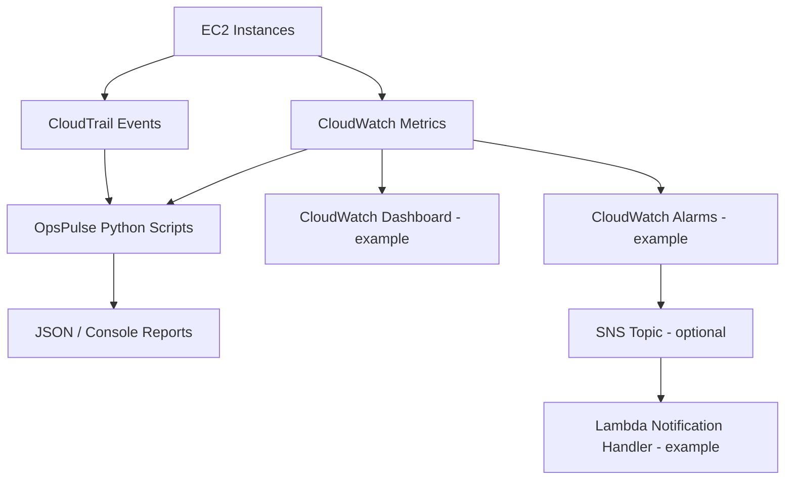

# OpsPulse — AWS Cloud Operations & Monitoring

OpsPulse is a portfolio project starter for monitoring AWS infrastructure and reviewing operational signals. It includes read-only Python scripts for EC2 inventory, CloudWatch metrics, and CloudTrail event review; sample CloudWatch dashboard/alarm definitions; a notification Lambda example; configuration; documentation; and basic tests.

> **Status:** Starter kit. Scripts and AWS resources have not been deployed or run against an AWS account. No real metrics, alarms, or monitoring results are included. Validate and deploy resources in your own AWS account before claiming live monitoring.

## Goals
- Collect a read-only inventory of EC2 instances.
- Retrieve CPU utilization metrics from CloudWatch.
- Review recent CloudTrail events.
- Provide example dashboard and alarm definitions.
- Demonstrate a notification handler for CloudWatch alarm events.

## Architecture


## Repository layout
```text
OpsPulse_AWS_Cloud/
├── README.md
├── requirements.txt
├── config/monitoring_config.json
├── scripts/aws_resource_inventory.py
├── scripts/cloudwatch_metrics.py
├── scripts/cloudtrail_events.py
├── dashboards/opspulse_dashboard.json
├── alarms/cloudwatch_alarms.json
├── lambda/alarm_notification_handler.py
├── docs/architecture.md
├── docs/monitoring_strategy.md
├── docs/alerting_strategy.md
└── tests/test_config.py
```

## Quick start
1. Install Python 3.10+ and AWS CLI.
2. Create and activate a virtual environment.
3. Install dependencies: `pip install -r requirements.txt`
4. Configure AWS credentials using an AWS-supported method (profile, role, or environment). Never commit credentials.
5. Set a profile if needed: `set AWS_PROFILE=your-profile` (Windows PowerShell) or `export AWS_PROFILE=your-profile` (Linux/macOS).
6. Run read-only commands:
   - `python scripts/aws_resource_inventory.py --region ap-south-1`
   - `python scripts/cloudwatch_metrics.py --region ap-south-1 --instance-id i-xxxxxxxxxxxxxxxxx --hours 6`
   - `python scripts/cloudtrail_events.py --region ap-south-1 --hours 24`

Scripts print JSON to stdout. Inventory and event scripts can write output to a file using `--output`. CloudWatch metric retrieval requires a real EC2 instance ID.

## Required IAM permissions (read-only scripts)
Grant only the required permissions to the identity used by these scripts. Example read-only actions include:
- `ec2:DescribeInstances`
- `cloudwatch:GetMetricStatistics`
- `cloudtrail:LookupEvents`

Use a least-privilege policy and review permissions with your administrator. These examples are not a complete production security policy.

## Dashboard and alarm examples
`dashboards/opspulse_dashboard.json` and `alarms/cloudwatch_alarms.json` are example definitions. Replace placeholder region/account/instance identifiers as needed, review metric dimensions, and deploy through the CloudWatch console, AWS CLI, CloudFormation, or IaC. They are not deployed by these scripts.


## Lambda example
`lambda/alarm_notification_handler.py` is a basic CloudWatch alarm event handler that logs the alarm payload. Configure a trigger and permissions only after reviewing the code. It does not send email by itself; SNS or another notification integration must be configured separately.

## Safety and cost notes
- The included scripts are read-only and do not create, modify, or delete AWS resources.
- CloudWatch custom metrics, log ingestion, dashboards, alarms, SNS, Lambda, and other AWS services may incur costs. Review pricing before deployment.
- Never commit `.env` files, access keys, secrets, or sensitive logs.
- CloudWatch Agent may be required for memory and filesystem metrics; these are not standard EC2 metrics in all configurations.

## Project roadmap
- [ ] Run inventory script against a test account.
- [ ] Verify metric retrieval for a test EC2 instance.
- [ ] Add CloudWatch dashboard widgets and deploy.
- [ ] Deploy and test alarms.
- [ ] Configure SNS delivery endpoint and validate notifications.
- [ ] Add optional CloudWatch Agent for memory/disk metrics.
- [ ] Add infrastructure-as-code deployment.
- [ ] Add scheduled reports and trend analysis.

## Author
Jay Prakash Pandey — Computer Science Graduate | Aspiring Cloud & Data Engineer

- LinkedIn: https://linkedin.com/in/jaypandey10/
- GitHub: https://github.com/prakashjaypandey

---
**Portfolio / learning project.** AWS deployment and live monitoring must be verified separately.
