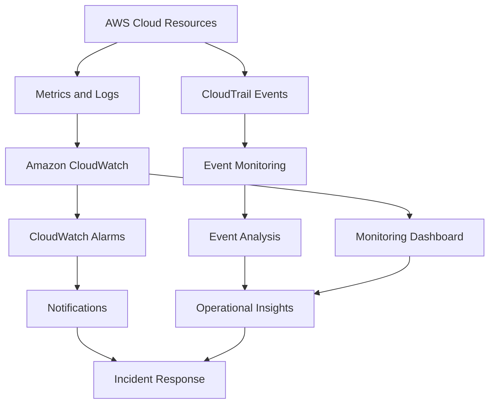

# ⚡ OpsPulse — AWS Cloud Operations & Monitoring Platform

### Cloud Infrastructure Monitoring | Operational Visibility | AWS Observability

---

## 📌 Project Overview

**OpsPulse** is an AWS cloud operations and monitoring project designed to provide visibility into cloud infrastructure health, resource utilization, operational performance, and potential system issues.

The project focuses on monitoring cloud resources, collecting operational metrics, analyzing system performance, and organizing monitoring information to support better infrastructure management and troubleshooting.

OpsPulse aims to demonstrate how AWS monitoring services can be used to build an operational monitoring workflow that helps identify resource bottlenecks, track infrastructure performance, detect abnormal behavior, and improve operational visibility.

The project is designed around AWS cloud services and monitoring concepts, including Amazon CloudWatch, AWS CloudTrail, Amazon EC2, Amazon S3, IAM, logging, metrics, alerts, and operational dashboards.

> **Project status:** This repository is currently being developed. The architecture and features described below represent the project design and planned implementation unless the corresponding code or AWS deployment has been completed and verified.

---

## 🎯 Project Objectives

- Monitor AWS cloud infrastructure health and availability.
- Collect infrastructure metrics and operational logs.
- Track resource utilization.
- Monitor EC2 performance.
- Identify abnormal resource usage patterns.
- Configure operational monitoring dashboards.
- Create threshold-based alerts.
- Analyze infrastructure events.
- Improve visibility into cloud operational activity.
- Demonstrate AWS monitoring and cloud operations concepts.
- Design a centralized monitoring approach for cloud resources.

---

## 🏗️ System Architecture

The planned architecture collects infrastructure metrics, logs, and events from AWS resources and organizes them into a monitoring and alerting workflow.



### Architecture Components

| Component | Purpose |
|---|---|
| Amazon EC2 | Compute infrastructure to monitor |
| Amazon CloudWatch | Metrics, logs, dashboards, alarms |
| AWS CloudTrail | Auditing AWS API activity |
| Amazon S3 | Log storage and archival |
| AWS IAM | Secure access and permissions |
| CloudWatch Alarms | Threshold-based alerting |
| SNS | Notification delivery (planned) |
| AWS Lambda | Automated event response (planned) |

---

## ☁️ AWS Services

### Amazon EC2

EC2 instances are the primary compute resources for monitoring demonstrations.

Metrics may include:

- CPU utilization
- Network traffic
- Instance status checks
- Disk-related metrics where configured
- Instance availability

The project aims to monitor resource usage and identify infrastructure performance issues.

### Amazon CloudWatch

CloudWatch acts as the central monitoring service.

It is intended to collect and visualize infrastructure metrics, monitor logs, configure alarms, and provide dashboards for operational visibility.

Potential monitoring capabilities:

- Metric collection
- Log monitoring
- Custom dashboards
- Threshold-based alerts
- Monitoring historical trends
- Operational troubleshooting

### AWS CloudTrail

CloudTrail provides visibility into AWS account activity and API events.

OpsPulse plans to use CloudTrail event information to understand:

- AWS API activity
- Resource creation and modification
- Configuration changes
- Access-related events
- Operational activity history

### Amazon S3

S3 may be used for long-term storage of exported logs and monitoring data.

Potential use cases:

- Log archival
- Historical monitoring data
- Audit information
- Exported reports
- Investigation datasets

### AWS IAM

IAM is responsible for controlling permissions and access to AWS resources.

The project follows the principle of least privilege by granting only the permissions required for each monitoring component.

---

## 📊 Monitoring Categories

OpsPulse is designed around several monitoring categories.

### 1. Infrastructure Health Monitoring

Monitor the availability and health of cloud resources.

Key indicators:

- EC2 instance status
- Instance status checks
- Resource availability
- Infrastructure events
- Service health information

### 2. Performance Monitoring

Track performance metrics to identify resource bottlenecks.

Potential indicators:

- CPU utilization
- Network in/out
- Memory utilization (with CloudWatch Agent where configured)
- Disk utilization (with additional monitoring configuration)
- Performance trends

### 3. Operational Monitoring

Analyze operational activity and infrastructure changes.

Potential indicators:

- API calls
- Resource configuration changes
- Instance lifecycle events
- Access activity
- Infrastructure modification events

### 4. Alert Monitoring

Identify metrics that cross configured thresholds.

Examples:

- High CPU utilization
- Failed EC2 status checks
- Resource availability issues
- Unusual operational events
- Sustained performance degradation

---

## 🚨 Alerting Strategy

OpsPulse is designed to use CloudWatch alarms to notify administrators when important thresholds are exceeded.

Example monitoring scenarios:

| Metric | Example Threshold | Action |
|---|---|---|
| CPU Utilization | Above 80% | Trigger alarm |
| Instance Status Check | Failed | Critical alert |
| Network Traffic | Unexpected spike | Investigate |
| Memory Usage | Above configured threshold | Alert |
| Disk Utilization | Above configured threshold | Alert |

Thresholds are examples only and should be adjusted according to workload requirements.

### Alert Workflow

```text
AWS Resource Metric
        │
        ▼
CloudWatch Metric
        │
        ▼
Threshold Evaluation
        │
        ├── Normal → Continue Monitoring
        │
        └── Threshold Exceeded
                  │
                  ▼
            CloudWatch Alarm
                  │
                  ▼
           SNS Notification
                  │
                  ▼
          Operational Response
```

---

## 📈 OpsPulse Dashboard

The planned dashboard will provide a centralized view of AWS infrastructure performance.

### Infrastructure Overview

- Total monitored instances
- Running instances
- Failed status checks
- Infrastructure health summary

### Resource Performance

- CPU utilization trends
- Network usage
- Memory metrics (where configured)
- Disk usage (where configured)

### Alert Summary

- Active alarms
- Alarm history
- Critical infrastructure events
- Alert frequency

### Operational Activity

- Resource changes
- AWS API activity
- Recent CloudTrail events
- Infrastructure modification activity

---

## 📝 Logging and Event Analysis

Operational logs are important for diagnosing cloud infrastructure issues.

OpsPulse aims to organize monitoring information to make troubleshooting easier.

Potential log sources:

- EC2 system logs
- Application logs
- CloudTrail logs
- CloudWatch Logs
- Custom operational logs

### Log Analysis Objectives

- Identify recurring errors.
- Investigate infrastructure events.
- Correlate errors with performance metrics.
- Track infrastructure changes.
- Support root-cause analysis.

---

## 🔍 Operational Use Cases

### Use Case 1 — High CPU Utilization

When CPU utilization remains above a configured threshold, CloudWatch can trigger an alarm.

Operational response:

1. Review CPU utilization trends.
2. Identify the affected EC2 instance.
3. Inspect application and system logs.
4. Investigate resource-intensive workloads.
5. Determine whether optimization or scaling is required.

### Use Case 2 — EC2 Health Check Failure

When an instance fails a status check, the monitoring workflow can notify the operator.

Operational response:

1. Review instance status.
2. Inspect system and instance status checks.
3. Review recent infrastructure events.
4. Investigate logs.
5. Restore service or replace the unhealthy resource if required.

### Use Case 3 — Unexpected Infrastructure Change

CloudTrail can provide information about AWS API activity.

Operational response:

1. Identify the event.
2. Review the API operation.
3. Check the event timestamp.
4. Identify the principal associated with the event.
5. Review the affected resource.
6. Investigate whether the change was expected.

### Use Case 4 — Resource Usage Trend

Monitoring historical metrics helps identify recurring resource utilization patterns.

Operational response:

1. Review metric history.
2. Compare usage across time periods.
3. Identify recurring spikes.
4. Determine workload patterns.
5. Recommend resource optimization.

---

## 🔐 Security and Access Management

OpsPulse is designed with AWS security best practices in mind.

Security considerations include:

- IAM roles instead of hardcoded credentials.
- Least-privilege permissions.
- Secure AWS resource access.
- Controlled log access.
- Monitoring of account activity.
- Protection of sensitive operational data.
- Secure handling of environment variables and credentials.

Credentials should never be committed to a public GitHub repository.

---

## 🧰 Technology Stack

| Technology | Purpose |
|---|---|
| AWS | Cloud infrastructure |
| Amazon EC2 | Compute resources |
| Amazon CloudWatch | Monitoring and observability |
| AWS CloudTrail | Audit and API activity |
| Amazon S3 | Log storage and archival |
| AWS IAM | Access control |
| Amazon SNS | Notifications |
| AWS Lambda | Automation and event response |
| Python | Automation and analysis |
| Git | Version control |
| GitHub | Project documentation and source code |

---

## 📁 Repository Structure

The repository is planned to evolve into the following structure as implementation progresses.

```text
OpsPulse-AWS-Cloud/
│
├── README.md
│
├── docs/
│   ├── architecture.md
│   ├── monitoring_strategy.md
│   └── alerting_strategy.md
│
├── config/
│   └── monitoring_config.json
│
├── scripts/
│   ├── aws_resource_inventory.py
│   └── cloudwatch_metrics.py
│
├── dashboards/
│   └── opspulse_dashboard.json
│
├── alarms/
│   └── cloudwatch_alarms.json
│
├── lambda/
│   └── alarm_notification_handler.py
│
├── logs/
│
├── reports/
│
├── tests/
│
└── requirements.txt
```

The above represents the planned structure, not necessarily the current repository contents.

---

## ⚙️ Implementation Roadmap

### Phase 1 — AWS Environment Setup

- [ ] Configure AWS account environment.
- [ ] Create IAM permissions.
- [ ] Launch EC2 monitoring resource.
- [ ] Configure AWS CLI.
- [ ] Verify connectivity to AWS services.

### Phase 2 — Monitoring Setup

- [ ] Configure CloudWatch monitoring.
- [ ] Collect EC2 metrics.
- [ ] Review instance health checks.
- [ ] Configure log collection.
- [ ] Create basic monitoring dashboard.

### Phase 3 — Alerting

- [ ] Configure CPU utilization alarm.
- [ ] Configure instance health alarm.
- [ ] Set up SNS notification topic.
- [ ] Test alert delivery.
- [ ] Document alarm response procedures.

### Phase 4 — Operational Event Monitoring

- [ ] Review CloudTrail events.
- [ ] Identify important infrastructure changes.
- [ ] Analyze resource lifecycle events.
- [ ] Create operational event summaries.

### Phase 5 — Automation

- [ ] Develop Python AWS monitoring scripts.
- [ ] Implement resource inventory collection.
- [ ] Automate metric retrieval.
- [ ] Develop Lambda-based event response.
- [ ] Add automated reporting.

### Phase 6 — Dashboard and Documentation

- [ ] Build centralized OpsPulse dashboard.
- [ ] Add infrastructure health indicators.
- [ ] Add performance metric visualizations.
- [ ] Document operational scenarios.
- [ ] Add screenshots of real AWS implementation.
- [ ] Publish project results.

---

## 🚧 Challenges and Considerations

Cloud operations monitoring involves several important engineering considerations:

- Choosing meaningful metric thresholds.
- Avoiding excessive alerts.
- Managing monitoring costs.
- Distinguishing temporary spikes from persistent issues.
- Collecting additional metrics using CloudWatch Agent.
- Managing log volume and retention.
- Protecting operational information.
- Correlating metrics with events.
- Ensuring monitoring coverage.
- Designing useful dashboards.

OpsPulse aims to address these considerations through clear monitoring rules, appropriate alert thresholds, structured logs, and centralized dashboards.

---

## 🔮 Future Enhancements

- [ ] Multi-instance monitoring.
- [ ] Automated EC2 inventory.
- [ ] CloudWatch dashboard automation.
- [ ] Custom metrics.
- [ ] Memory and disk monitoring using CloudWatch Agent.
- [ ] SNS email notifications.
- [ ] Lambda automation for selected events.
- [ ] CloudTrail event analysis.
- [ ] Infrastructure anomaly detection.
- [ ] Cost monitoring and optimization.
- [ ] Cloud resource tagging analysis.
- [ ] Monitoring reports.
- [ ] Incident tracking.
- [ ] Infrastructure as Code using Terraform.
- [ ] Container monitoring.
- [ ] Operational analytics dashboard.

---

## 🎓 Learning Outcomes

This project is intended to demonstrate practical knowledge of:

- AWS cloud fundamentals
- Cloud infrastructure monitoring
- Metrics and logs
- Observability
- EC2 management
- CloudWatch dashboards
- CloudWatch alarms
- CloudTrail auditing
- IAM security
- AWS automation
- Event-driven architecture
- Python scripting
- Incident investigation
- Cloud operations practices

---

## 👨‍💻 Author

**Jay Prakash Pandey**

Computer Science Graduate | Aspiring Cloud & Data Engineer

Technical Interests:

- AWS Cloud
- Data Engineering
- Cloud Operations
- Infrastructure Monitoring
- Python Automation
- Big Data
- ETL Pipelines

🔗 [LinkedIn](https://linkedin.com/in/jaypandey10)

💻 [GitHub](https://github.com/prakashjaypandey)

---

## ⚠️ Disclaimer

OpsPulse is an educational portfolio project intended to demonstrate AWS cloud monitoring, observability, and operational concepts.

The architecture and roadmap may describe planned capabilities. AWS resources, dashboards, alarms, automations, and monitoring integrations should only be considered implemented when deployed and verified.

---

⭐ **OpsPulse — Turning Cloud Metrics into Operational Insights.**
